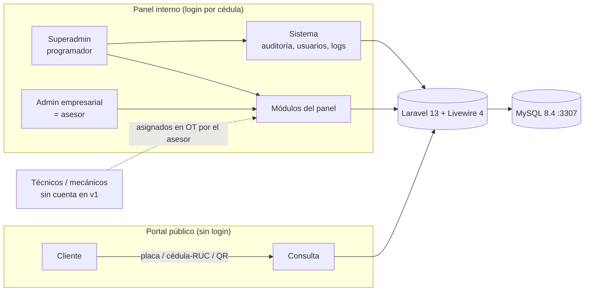
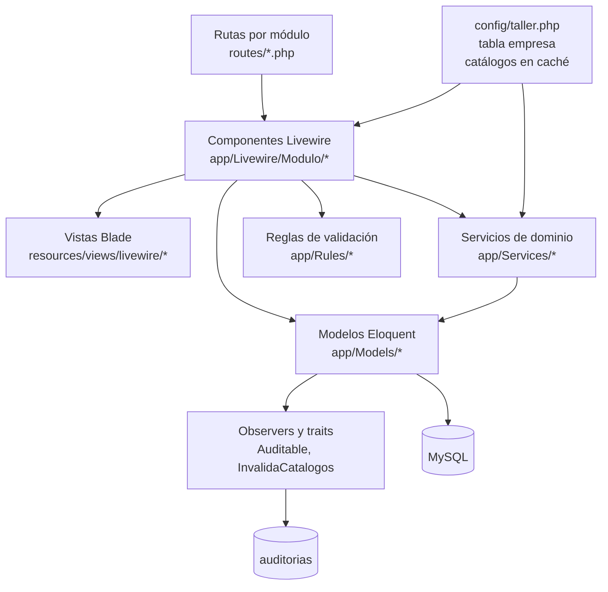
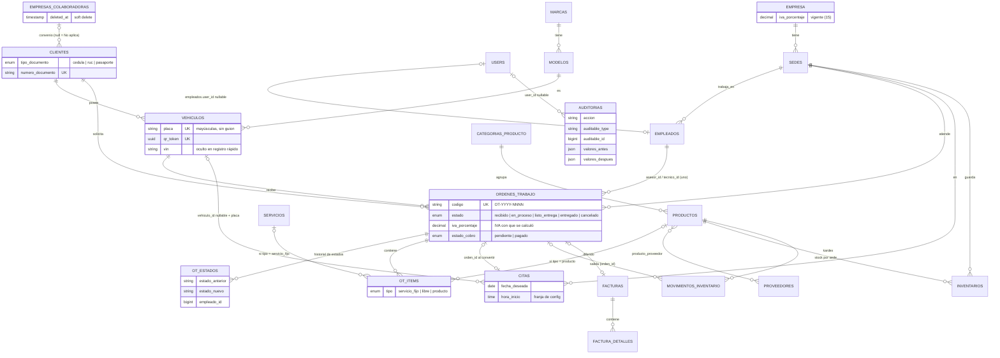
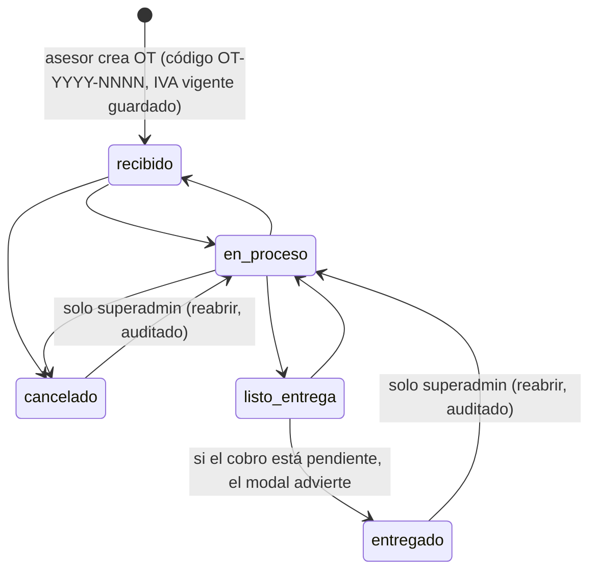
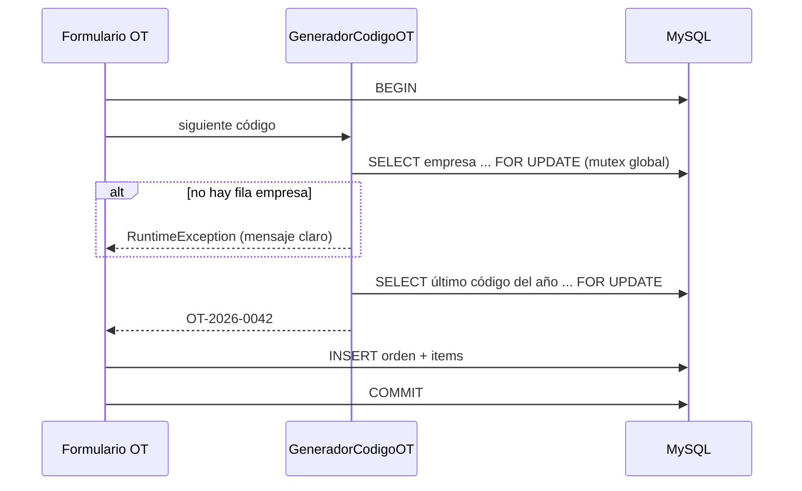
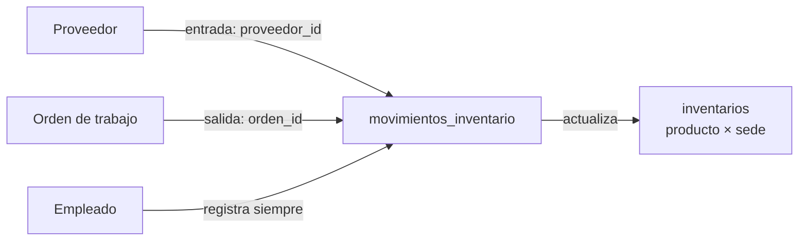
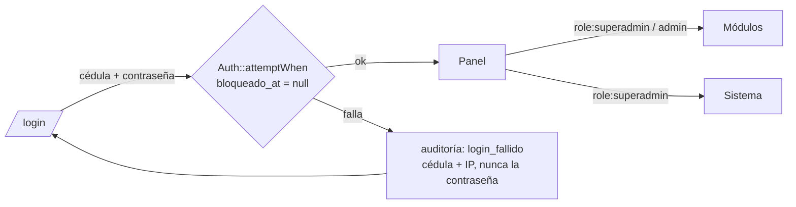
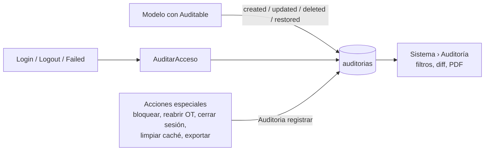
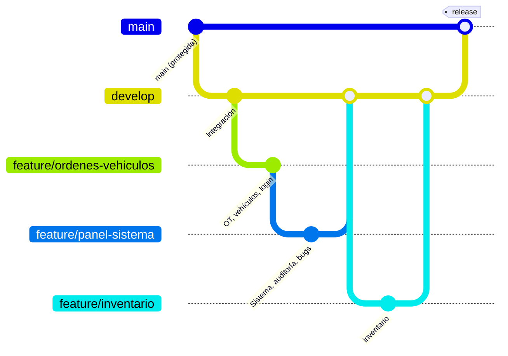

# Arquitectura — Sistema de Taller Automotriz

> Documento de referencia para personas y agentes (Claude Code) que trabajan en el proyecto.
> Explica **qué hace cada parte**, cómo se conectan y qué reglas no se rompen.
> Actualizado: **2026-11-20** · Verificado contra la rama `feature/panel-sistema`, commit `ae4e4df` (último commit de código; los commits posteriores solo agregan documentación).
> Entrega comprometida: **11 de diciembre de 2026**.
> Fuente original: documento de traspaso del 2026-11-20. Lo que se verificó contra el código ya no es supuesto; lo que sigue abierto está en §15.

---

## Índice

1. Visión general
2. Actores y permisos
3. Stack y entorno
4. Arquitectura en capas
5. Mapa de carpetas (qué hace cada cosa)
6. Módulos funcionales
7. Modelo de datos
8. Flujos clave
9. Lógica de negocio (servicios, reglas, observers)
10. Rendimiento: "optimizado como un videojuego"
11. Diseño visual y movimiento
12. Configuración: nada quemado
13. Pruebas y calidad
14. Equipo, propiedad del código y Git
15. Supuestos, ambigüedades y riesgos
16. Glosario

---

## 1. Visión general

Sistema web para **dar seguimiento a los vehículos que pasan por un taller automotriz con varias sedes** (Quito, Ecuador).

Tiene dos caras:

- **Panel interno** (con login): el personal administrativo registra clientes, vehículos, órdenes de trabajo (OT), citas, empleados, convenios y configuración. El superadmin tiene además la sección **Sistema** (auditoría, usuarios, sesiones, eliminados, estado, logs).
- **Portal público** (sin login): el cliente escribe su **placa** o su **cédula/RUC** (o escanea el **QR** del vehículo) y ve la descripción del vehículo, su historial de mantenimiento y la orden en curso; puede pedir cita.



---

## 2. Actores y permisos

| Actor | Rol de acceso (Spatie) | Qué puede hacer | Cómo entra |
|---|---|---|---|
| Programador | `superadmin` | Todo lo del admin + **Datos del taller** (incluye IVA) + **Sistema** (auditoría, usuarios y roles, sesiones, registros eliminados, estado, logs) + reabrir OT entregadas/canceladas | Login por cédula |
| Admin empresarial / asesor | `admin` | Operar el negocio: OT, citas, vehículos, clientes, empresas colaboradoras, empleados, catálogos. Recibe **403** en Datos del taller y en Sistema aunque escriba la URL | Login por cédula |
| Operador (técnico/mecánico) | ninguno en v1 | Nada en el sistema. Es un registro en `empleados` (cargo `tecnico` o `mecanico`) que el asesor asigna a las OT | No entra |
| Cliente | ninguno | Consultar su vehículo y pedir cita en el portal público | Sin login: placa, cédula/RUC o QR |
| Usuario sin rol | ninguno | Nada: **403** en el panel y en `settings/*` | — |

Distinción importante:

- **Cargo** (`empleados.cargo`: `admin`, `asesor`, `tecnico`, `mecanico`, constantes en `Empleado::CARGOS`): qué hace la persona en el taller. Qué cargos pueden ser técnico o asesor de una OT se define en `config/taller.php → ordenes.cargos_tecnico / cargos_asesor`.
- **Rol de acceso** (Spatie): qué puede hacer en el sistema. Son datos en BD.

Un empleado puede existir sin usuario (técnico) y un usuario puede estar vinculado a un empleado (la admin de los seeders, María F. López). Los superadmins de los seeders **no** tienen empleado: al crear una OT eligen el asesor en un selector.

Un usuario puede estar **bloqueado** (`users.bloqueado_at`): no puede iniciar sesión y pierde la sesión abierta en su siguiente petición.

---

## 3. Stack y entorno

### Versiones fijadas (verificadas en `composer.lock`; no se actualizan sin acuerdo)

| Pieza | Versión |
|---|---|
| PHP | 8.3.x (`^8.3`; Laragon 8.3.36) |
| Laravel | 13.43.0 |
| Livewire | 4.4.8 |
| Volt | 1.11.2 (solo pantallas de auth y "Mi perfil") |
| Flux | 2.21.0 (solo dentro de "Mi perfil"; **no se usa en el panel**) |
| spatie/laravel-permission | 8.5.0 |
| barryvdh/laravel-dompdf | 3.1.2 (PDF de OT y de auditoría) |
| simplesoftwareio/simple-qrcode | 4.2.0 (QR de vehículos) |
| barryvdh/laravel-debugbar | 4.4.5 (solo `require-dev`) |
| MySQL | 8.4.3 |
| CSS | Tailwind 4 (plano) |

`composer.lock` y `package-lock.json` se commitean. Instalar siempre con `composer install` y `npm ci`. Extensión **BCMath** cargada (la usa `App\Support\Dinero`; tiene respaldo sin ella).

### Entorno local (Laragon, Windows)

| Elemento | Valor |
|---|---|
| Ruta | `C:\laragon\www\Taller-Automotriz` |
| URL | `http://taller-automotriz.test:8080` (Apache, vhost de Laragon) |
| Servidor | Apache **8080**. No se usa `php artisan serve` |
| MySQL | puerto **3307**. BD `taller_automotriz` (desarrollo) y `taller_automotriz_test` (tests en MySQL) |
| Sesiones / caché | `SESSION_DRIVER=database`, `CACHE_STORE=database` |
| Zona horaria / idioma | `America/Guayaquil` / `es` |

Trampa conocida: variables de entorno "fantasma" (`DB_*`, `APP_KEY`) de otro proyecto pueden pisar el `.env`. Revisar con `Get-ChildItem Env:` y limpiar con `Remove-Item Env:DB_*,Env:APP_KEY`.

---

## 4. Arquitectura en capas

El sistema es un **monolito Laravel** con componentes Livewire de página completa. No hay API REST ni SPA: la interactividad la da Livewire (y Alpine para lo puramente visual), y la navegación sin recarga la da `wire:navigate` con el marco del panel persistente (`@persist`).



| Capa | Responsabilidad | No debe |
|---|---|---|
| **Rutas** (`routes/{modulo}.php`) | Asociar URL → componente Livewire, con middleware `auth` + `role:` | Tener lógica |
| **Componentes Livewire** | Estado de la pantalla, validación, orquestar llamadas | Contener reglas de negocio complejas (van a Services) ni SQL crudo disperso |
| **Vistas Blade** | Presentación con Tailwind y la paleta ERP | Hacer consultas (con `preventLazyLoading` un lazy load lanza excepción en desarrollo) |
| **Services** | Reglas de negocio reutilizables y transaccionales (código OT, totales, eliminar convenios) | Conocer la UI |
| **Models** | Relaciones, casts, scopes, accessors, transiciones de estado de OT | Lógica de pantalla |
| **Observers / traits** | Efectos automáticos al guardar: código OT, IVA histórico, traza de estados, km, `qr_token`, invalidar caché de catálogos, auditoría | Lógica que dependa de la pantalla |
| **Rules** | Validaciones ecuatorianas reutilizables | — |
| **Config** | Parámetros del negocio y del sistema | — |

Regla práctica: si una regla se usa en más de un componente, o necesita transacción o bloqueo, va a `app/Services/`.

---

## 5. Mapa de carpetas (qué hace cada cosa)

```
app/
  Livewire/
    Ordenes/          Listado (KPIs, búsqueda, cambio de estado con transiciones), Formulario (crear/editar OT,
                      alta rápida, ítems, técnico, asesor, checklist, totales, cobro)
    Vehiculos/        Listado, Formulario (alta/edición), Ficha (historial, QR)
    Clientes/         Listado con modal de alta/edición y convenio
    Convenios/        Empresas colaboradoras: alta/edición y "Eliminar" (soft delete con modal)
    Citas/            Agenda interna (franjas de config), confirmar, cancelar, convertir en OT
    Empleados/        Personal, cargo, sede; opcionalmente crea su usuario de acceso
    Configuracion/    DatosEmpresa (solo superadmin: razón social, RUC, IVA…), Catalogos (servicios,
                      checklist de recepción, marcas/modelos)
    Sistema/          Solo superadmin: Auditoria, Usuarios, Sesiones, Eliminados, Estado, Logs (+ trait SoloSuperadmin)
    Publico/          Inicio (consulta por placa o cédula/RUC), VistaVehiculo (/q/{token}: ficha y solicitud de cita)
    Actions/          Logout (invocable: lo usa la ruta POST /logout)
    Inventario/       ⚠ ZONA DEL SEGUNDO DEV (vacío)
  Models/             Empresa, Sede, User, Empleado, EmpresaColaboradora (SoftDeletes), Cliente, Marca, Modelo,
                      Vehiculo, Servicio, ChecklistItem, OtEstado (historial), OrdenTrabajo, OtItem, Cita,
                      Factura, FacturaDetalle, Auditoria
    Concerns/         Auditable (auditoría automática), InvalidaCatalogos (borra la caché al guardar)
    Inventario/       ⚠ ZONA DEL SEGUNDO DEV (CategoriaProducto, Proveedor, Producto, Inventario, MovimientoInventario)
  Observers/          OrdenTrabajoObserver (código, IVA, traza de estados, km), VehiculoObserver (qr_token)
  Services/           GeneradorCodigoOT, CalculadorDescuento, GestorConvenios
  Listeners/          AuditarAcceso (login, logout, login fallido)
  Http/Middleware/    BloquearUsuarioInhabilitado (cierra la sesión de un usuario bloqueado)
  Http/Controllers/   OrdenPdfController, EtiquetaQrController
  Rules/              CedulaRucEcuador, PlacaEcuador
  Support/            Catalogos (caché), Dinero (BCMath), Placa, Mascara (portal), LectorLog (visor de logs)

config/
  taller.php          Parámetros del sistema (ver §12)
  livewire.php        component_layout + barra de progreso de navegación (#1E40AF). No borrar.

resources/
  css/app.css         Tailwind 4 + @theme con la paleta (--color-erp-*)
  css/panel.css       Componentes del panel (alias --c-* de la paleta)
  css/movimiento.css  Utilidades de animación (únicas, reutilizadas)
  js/app.js           Componentes Alpine: indicadorNav, toasts, cerrarSesion; resaltado de fila nueva
  views/components/layouts/
    panel.blade.php   Layout del panel: marco persistente @persist('marco-panel') = cabecera + menú
    app.blade.php     Layout por defecto (Mi perfil): envuelve el del panel
    publico.blade.php Layout del portal
    auth/simple.blade.php  Login y recuperación
  views/livewire/<modulo>/…   Vistas de cada componente (inventario/: ⚠ segundo dev)
  views/pdf/          orden.blade.php, auditoria.blade.php

routes/
  web.php             settings/* (auth + rol del panel) y carga los demás
  ordenes.php         /panel, /panel/ordenes…, PDF
  clientes.php        /panel/clientes y /panel/empresas-colaboradoras
  vehiculos.php       /panel/vehiculos…, etiqueta QR
  citas.php           /panel/citas
  empleados.php       /panel/empleados, /panel/catalogos, /panel/configuracion (solo superadmin)
  sistema.php         /panel/sistema/* (solo superadmin)
  publico.php         /, /q/{token} (throttle)
  auth.php            login, recuperar contraseña, verificación, POST /logout
  inventario.php      ⚠ ZONA DEL SEGUNDO DEV (hoy vacío)

database/
  migrations/         2026_11_20_1000xx_* (esquema base) + 2026_11_21/22/23_* (ver §7.5)
  seeders/            RolesSeeder, OrganizacionSeeder, CatalogosSeeder, DemoOperacionSeeder

lang/es/              validation.php, passwords.php (los textos de las vistas siguen en Blade: ver §15)
tests/Feature/        Ver §13
tests/Unit/           MovimientoCssTest (reglas de animación)
tests/Concurrencia/   Proceso hijo del test de concurrencia del código OT
```

---

## 6. Módulos funcionales

| Módulo | Dueño | Qué hace | Tablas principales | Estado |
|---|---|---|---|---|
| Autenticación | Sebastian | Login por cédula + contraseña, sin registro público, bloqueo de usuarios, auditoría de accesos | `users`, Spatie, `sessions` | Hecho |
| Layout / navegación | Sebastian | Marco persistente, `wire:navigate`, toasts, animaciones | — | Hecho |
| Clientes | Sebastian | Alta/edición, búsqueda, convenio asociado | `clientes` | Hecho |
| Empresas colaboradoras | Sebastian | Convenios con % de descuento; eliminar = soft delete (clientes → "No aplica") | `empresas_colaboradoras` | Hecho |
| Vehículos / QR | Sebastian | Registro (rápido y completo), placa única normalizada, QR por `qr_token` | `vehiculos`, `marcas`, `modelos` | Hecho |
| Órdenes de trabajo | Sebastian | Crear OT, líneas (servicio fijo, libre; producto = Inventario), técnico, asesor, estados con transiciones, checklist, totales con descuento e IVA histórico, cobro simple, PDF | `ordenes_trabajo`, `ot_items`, `ot_estados`, `servicios`, `checklist_items` | Hecho |
| Citas | Sebastian | Agenda en franjas configurables (08–14, 60 min) | `citas` | Hecho |
| Empleados | Sebastian | Personal, cargo, sede, vínculo opcional a usuario | `empleados` | Hecho |
| Configuración | Sebastian | Datos del taller e IVA (superadmin); catálogos (servicios, checklist, marcas/modelos). **No hay pantalla de sedes** (se cargan por seeder) | `empresa`, catálogos | Hecho |
| Sistema | Sebastian | Auditoría (filtros, diff, PDF), usuarios y roles, sesiones activas, registros eliminados, estado del sistema, visor de logs | `auditorias`, `users`, `sessions` | Hecho |
| Portal público | Sebastian | Consulta por placa / cédula-RUC / QR; solicitud de cita | lectura de varias | Hecho |
| **Inventario** | **Segundo dev** | Productos, categorías, proveedores, stock por sede, kardex | 6 tablas de inventario | Por hacer |
| Facturación | — | UI de facturas y SRI | `facturas`, `factura_detalles` | Diferido |

---

## 7. Modelo de datos

23 tablas de negocio (22 del esquema base + `auditorias`), más las de Laravel (`users`, `sessions`, `cache`, `jobs`…) y Spatie.

### 7.1 Grupos

- **Organización y personas:** `empresa`, `sedes`, `users`, `empleados`, `empresas_colaboradoras` (soft delete), `clientes`
- **Vehículos:** `marcas`, `modelos`, `vehiculos`
- **Catálogos de operación:** `servicios`, `checklist_items`
- **Órdenes:** `ordenes_trabajo`, `ot_items`, `ot_estados` (historial de cambios de estado)
- **Inventario:** `categorias_producto`, `proveedores`, `productos`, `producto_proveedor`, `inventarios`, `movimientos_inventario`
- **Facturación (diferida):** `facturas`, `factura_detalles`
- **Citas:** `citas`
- **Sistema:** `auditorias`

### 7.2 Diagrama entidad-relación (simplificado)

Solo claves y campos relevantes. La verdad está en las migraciones.



### 7.3 Decisiones de modelado

- **Multi-sede desde el inicio.** OT, citas, empleados e inventario cuelgan de una sede.
- **Placa única global**, normalizada (mutator en `Vehiculo`: mayúsculas, sin guion) antes de guardar y antes de buscar.
- **`qr_token` (UUID)** en cada vehículo (lo genera `VehiculoObserver`). El QR apunta a `/q/{qr_token}`, nunca al `id`.
- **Un técnico por OT** (`ordenes_trabajo.tecnico_id`, nullable) y un asesor (`asesor_id`).
- **Estados de OT**: columna `enum` + constantes `OrdenTrabajo::ESTADOS`; las transiciones permitidas en `config/taller.php`. `ot_estados` **no es un catálogo**: es el historial (quién cambió qué y cuándo).
- **IVA histórico**: cada OT guarda `iva_porcentaje`.
- **Eliminar = soft delete** (`deleted_at`) en vez de `activo`: hoy en `empresas_colaboradoras`.
- **Inventario no se vincula a clientes.** Salidas llevan `orden_id`; entradas `proveedor_id`; siempre `empleado_id`, `producto_id`, `sede_id`.
- **Facturación** tiene tablas con campos SRI nullable, sin UI en v1.

### 7.4 Índices (verificados en las migraciones)

| Tabla | Índice | Por qué |
|---|---|---|
| `vehiculos` | UNIQUE `placa`, UNIQUE `qr_token`, FK `cliente_id` | Consulta pública y listado por cliente |
| `clientes` | UNIQUE `numero_documento`, `nombres` | Consulta pública por cédula/RUC, búsqueda |
| `ordenes_trabajo` | UNIQUE `codigo`, `fecha_ingreso`, `(estado, fecha_ingreso)`, `(vehiculo_id, fecha_ingreso)` + FKs | Listado de activas, historial del vehículo |
| `ot_items` | FK `orden_id` | Detalle de OT |
| `citas` | `placa`, `(fecha_deseada, hora_inicio)`, `(estado, fecha_deseada, hora_inicio)` | Agenda y KPI de pendientes |
| `inventarios` | UNIQUE `(producto_id, sede_id)` | Stock por sede |
| `movimientos_inventario` | `(producto_id, sede_id, created_at)` | Kardex |
| `users` | UNIQUE `cedula` | Login |
| `auditorias` | `(auditable_type, auditable_id)`, `(user_id, created_at)`, `created_at` | Historial de un registro, filtros por usuario y fecha |

No hay índice compuesto `(sede_id, estado)` en OT: el listado no filtra por sede (ver §15, filtrado por sede).

### 7.5 Migraciones posteriores al esquema base

| Migración | Qué hace |
|---|---|
| `2026_11_21_000001_add_cedula_to_users_table` | `users.cedula` UNIQUE (login), correo opcional |
| `2026_11_22_000001_add_performance_indexes` | Índices de OT y citas medidos en `RendimientoConsultasTest` |
| `2026_11_23_000001_soft_delete_empresas_colaboradoras` | `deleted_at`; las inactivas pasan a eliminadas y sus clientes a "No aplica"; elimina `activo` |
| `2026_11_23_000002_create_auditorias_table` | Tabla de auditoría |
| `2026_11_23_000003_add_bloqueado_at_to_users_table` | Bloqueo de acceso |
| `2026_11_23_000004_add_iva_porcentaje_to_ordenes_trabajo_table` | IVA histórico (rellenado con el % vigente) |

---

## 8. Flujos clave

### 8.1 Consulta pública (placa, cédula/RUC o QR)

```mermaid
sequenceDiagram
    actor C as Cliente
    participant P as Livewire Publico\Inicio
    participant R as Rules (PlacaEcuador / CedulaRucEcuador)
    participant DB as MySQL
    C->>P: elige tipo y escribe (acción "consultar")
    P->>P: RateLimiter por IP (config taller.portal)
    P->>P: normaliza (placa: mayúsculas sin guion; documento: sin espacios)
    P->>R: valida formato / módulo 10
    alt Placa
        P->>DB: qr_token por placa (índice único)
        P-->>C: wire:navigate a /q/{qr_token}
    else Cédula/RUC
        P->>DB: vehículos del cliente (coincidencia exacta del documento)
        P-->>C: uno → ficha; varios → lista para elegir
    end
    Note over C,P: QR: /q/{qr_token} (Publico\VistaVehiculo) abre la ficha directamente
```

Qué muestra la ficha (`VistaVehiculo`): placa, marca, modelo, año, color, VIN **enmascarado**, propietario con nombre y documento **enmascarados** (`App\Support\Mascara`), kilometraje actual y próximo mantenimiento, la OT en curso con su estado, y el historial (fecha, km y descripción de los servicios). **No muestra precios, notas internas, diagnóstico ni datos de terceros.** Desde la ficha se solicita cita (límite por IP) o se escribe al taller por WhatsApp.

Seguridad: throttle de las rutas públicas (`taller.portal.throttle_por_minuto`, 30/min) + limitador propio de las acciones Livewire de consulta (15/min) y de cita (3 cada 10 min).

### 8.2 Ciclo de vida de una orden de trabajo

Transiciones en `config/taller.php → ordenes.transiciones` (el listado solo ofrece las válidas y el backend las valida):



Pasos de creación:

1. Buscar o registrar vehículo (alta rápida, VIN oculto).
2. El cliente sale del vehículo; su convenio determina el descuento.
3. Líneas en `ot_items`: `servicio_fijo` (precio de `servicios`), `libre` (manual), `producto` (**integración Inventario**, `// TODO INVENTARIO` en `app/Livewire/Ordenes/Formulario.php`).
4. Técnico (empleado activo con cargo en `cargos_tecnico`) y asesor (el empleado del usuario; si no tiene, se elige entre `cargos_asesor`).
5. Checklist de recepción (`checklist_items`).
6. Totales: subtotal → descuento (`CalculadorDescuento`) → IVA (de la OT o el vigente) → total.
7. Guardar en transacción. `GeneradorCodigoOT` asigna el código de forma atómica; el observer guarda la traza en `ot_estados`.
8. Cobro simple: `estado_cobro`, `forma_cobro`. PDF con dompdf (usa el IVA guardado).

### 8.3 Generación del código de OT (concurrencia)



El orden de bloqueo (primero `empresa`, luego OT) evitó los deadlocks. **No cambiarlo.** `ConcurrenciaCodigoOtTest` (grupo `mysql`) lanza 4 procesos PHP × 10 OT en paralelo y verifica cero duplicados, cero deadlocks y secuencia continua.

### 8.4 Citas

- El cliente elige fecha (hasta `dias_anticipacion_max` días) y una franja.
- Franjas desde `config/taller.php → citas` (`hora_apertura` 8, `hora_cierre` 14, `duracion_franja_min` 60): `Cita::franjas()`.
- **No hay límite de capacidad por franja ni por sede**: solo se evita la cita duplicada del mismo vehículo en la misma fecha y franja.

### 8.5 Inventario (segundo dev)



- El stock vive en `inventarios`; el historial en `movimientos_inventario` (kardex).
- Cada movimiento actualiza el stock en la misma transacción, con `lockForUpdate` sobre `inventarios`.
- Para auditar sus modelos basta `use Auditable;` y agregarlos a `Auditoria::MODULOS`.
- Integración con OT: el momento de descontar stock sigue abierto (§15).

### 8.6 Autenticación



- Login es una página Volt sobria; 5 intentos por cédula+IP.
- Sin registro público. Usuarios desde *Sistema > Usuarios y roles*, desde *Empleados* o seeders.
- Logout: `fetch` POST `/logout` (Alpine) + `Livewire.navigate('/')`.
- Seeders: 2 `superadmin` + 1 `admin`. En desarrollo usuario = contraseña = cédula. **Cambiar antes de producción.**

### 8.7 Auditoría



- 1 INSERT por evento, sin SELECT (usa los atributos en memoria; `sede_id` sale del propio registro).
- `actualizado` guarda solo los campos que cambiaron (antes/después). `password` y secretos se registran como `[oculto]`; `remember_token` no se registra.
- Los updates masivos por query builder no disparan eventos (no quedan auditados).

---

## 9. Lógica de negocio

| Pieza | Ubicación | Qué hace |
|---|---|---|
| `GeneradorCodigoOT` | `app/Services/` | Código atómico por año (formato en config); excepción clara sin fila `empresa` |
| `CalculadorDescuento` | `app/Services/` | Totales de OT con `Dinero` (exacto) |
| `GestorConvenios` | `app/Services/` | Eliminar (clientes → "No aplica" + soft delete, en transacción) y restaurar |
| `Dinero` | `app/Support/` | Redondeo half-up a 2 decimales con BCMath; respaldo en centavos enteros |
| `Catalogos` | `app/Support/` | Catálogos en UNA clave de caché; se invalida al guardar (`InvalidaCatalogos`) |
| IVA | `empresa.iva_porcentaje` / `ordenes_trabajo.iva_porcentaje` | Vigente / histórico |
| `OrdenTrabajoObserver` | `app/Observers/` | Código, IVA histórico, traza en `ot_estados`, `fecha_entrega`, km del vehículo |
| `VehiculoObserver` | `app/Observers/` | Genera `qr_token` |
| `Auditable` | `app/Models/Concerns/` | Auditoría automática |
| `CedulaRucEcuador` | `app/Rules/` | Cédula módulo 10; RUC natural = cédula + 001; sociedades por estructura |
| `PlacaEcuador` | `app/Rules/` | `AAA1234`, `AAA123`, motos `AB123C`; se guarda en mayúsculas sin guion |

Orden de cálculo (verificado en `CalculadorDescuento`): `subtotal = Σ round(cant × precio, 2)`, `descuento = round(subtotal × %convenio, 2)`, `base = subtotal − descuento`, `iva = round(base × iva%, 2)`, `total = base + iva`.

---

## 10. Rendimiento: "optimizado como un videojuego"

| Técnica | Dónde | Regla |
|---|---|---|
| `wire:navigate` en todos los enlaces internos | Panel, portal, login | Lo vigila `NavegacionTest` (salvo PDF/etiquetas en otra pestaña) |
| `@persist('marco-panel')` | Cabecera + menú del panel | No se re-renderiza en el navegador al navegar; el ítem activo lo marca Alpine |
| Barra de progreso | `config/livewire.php` | Color `#1E40AF` |
| `wire:model.live.debounce.300ms` | Buscadores | Nunca `.live` sin debounce en texto |
| `wire:key` | Todo `@foreach`, incluidos `<option>` | Obligatorio |
| `#[Computed]` | Datos derivados | En vez de propiedades públicas pesadas |
| `#[Lazy]` + placeholder | Estado del sistema, Logs | Carga diferida con skeleton |
| Bajo demanda | Diff de auditoría | Se renderiza solo la fila abierta (de 245 KB a 72 KB) |
| Eager loading + `preventLazyLoading` | Consultas | Un N+1 lanza excepción fuera de producción |
| Paginación (`config/taller.php → paginacion`) | Listados | Nunca `->get()` de tablas que crecen |
| Caché de catálogos con invalidación | Catálogos, empresa | Una lectura por request |
| `wire:loading` / `wire:dirty` | Botones y formularios | "Guardando…", "Cambios sin guardar" |

Medición: `php vendor/bin/phpunit --group=medicion` (consultas, ms, HTML y payload Livewire por pantalla) y `RendimientoConsultasTest` (topes y N+1).

---

## 11. Diseño visual y movimiento

| Token (`@theme` de `app.css`) | Valor | Uso |
|---|---|---|
| `--color-erp-fondo` | `#F4F5F7` | `body` |
| `--color-erp-superficie` + `--color-erp-borde` | `#FFFFFF` + 1px `#D1D5DB` | Tarjetas, tablas, formularios |
| `--color-erp-texto` | `#1F2937` | Texto principal |
| `--color-erp-acento` | `#1E40AF` | Botón primario, enlaces, foco, ítem activo, barra de progreso |
| `--c-whatsapp` (panel.css) | `#15803D` | Única excepción: botón de WhatsApp |

`panel.css` usa alias `--c-*` que apuntan a `--color-erp-*`: los hex viven en un solo lugar. Los PDF (dompdf) llevan sus colores en línea porque dompdf no lee variables CSS.

Reglas: sin degradados, sombras grandes, ilustraciones, emojis ni look "startup/IA"; un solo acento; estados con texto, no solo color; tablas densas; sin logo real (placeholder con el nombre de `empresa`); sin Flux en el panel (solo dentro de "Mi perfil").

### Movimiento (`resources/css/movimiento.css`)

| Elemento | Animación |
|---|---|
| Cambio de página | Fundido corto del contenido (`.pagina-entra`) |
| Ítem activo del menú | Indicador que se desliza (`transform`) |
| Modales | Fondo con fundido; panel fundido + escala 0.98 → 1; al cerrar, fundido de salida (`wire:transition`) |
| Fila eliminada | Se desvanece (`wire:transition` en la fila) |
| Fila nueva | Resaltado tenue del acento que se apaga en ~1 s (`fila-nueva`) |
| Toasts | Arriba a la derecha, entran con 4 px, se van solos (3,5 s; error 6 s) |
| Dropdowns | Fundido + 4 px |
| Listados y buscadores | `<x-skeleton-tabla>` gris neutro, estático |
| Botones | `wire:loading` + deshabilitado; `[data-loading]` atenúa cualquier botón que disparó una acción |

120–200 ms, ease-out al entrar, ease-in al salir; solo `opacity` y `transform`; `prefers-reduced-motion` → solo opacidad. Sin librerías (Alpine, `x-transition`, `wire:transition`). `tests/Unit/MovimientoCssTest.php` lo verifica.

---

## 12. Configuración: nada quemado

| Dónde | Qué va |
|---|---|
| `.env` | Credenciales, URL, puertos (`DB_PORT=3307`), entorno, drivers |
| `config/taller.php` | `iva_por_defecto` (respaldo), `mantenimiento.intervalo_km`, `citas` (apertura, cierre, `duracion_franja_min`, días máx.), `portal` (throttle y límites), `paginacion` (por listado), `codigo_ot` (prefijo, relleno), `ordenes` (`cargos_tecnico`, `cargos_asesor`, `transiciones`, `reabrir_a`), `auditoria.max_filas_pdf`, `cache.ttl_seg` |
| `config/livewire.php` | Layout por defecto y barra de progreso |
| Tabla `empresa` | Nombre, RUC, dirección, teléfono, `iva_porcentaje` vigente |
| Tablas de catálogo | Marcas, modelos, servicios, checklist |
| Constantes de modelo | Estados de OT/citas, cargos, formas de cobro, combustibles: el código ramifica por ellos (las **transiciones** sí están en config) |
| Spatie | Roles como datos |
| `lang/es/*` | Validación y contraseñas. Los textos de las vistas siguen en Blade (pendiente, §15) |

---

## 13. Pruebas y calidad

- **Por defecto SQLite en memoria** (`phpunit.xml`): `php artisan test` → 110 tests.
- **MySQL** (`phpunit.mysql.xml`, BD `taller_automotriz_test` en 3307): `php vendor/bin/phpunit --configuration=phpunit.mysql.xml` → 111 tests (incluye el grupo `mysql`: concurrencia real del código OT). Alternativa con variables: `$env:DB_CONNECTION="mysql"; $env:DB_PORT="3307"; $env:DB_DATABASE="taller_automotriz_test"; php artisan test`.
- **Medición** (grupo `medicion`, fuera de la suite): `php vendor/bin/phpunit --group=medicion`.
- Suites relevantes: `HumoRutasTest` (todas las rutas GET × invitado/sin rol/admin/superadmin), `MontajeComponentesTest` (cada componente con su rol + acciones), `NavegacionTest`, `RendimientoConsultasTest`, `AuditoriaTest`, `SistemaTest`, `ConveniosEliminarTest`, `BugsVerificacionTest`, `ConcurrenciaCodigoOtTest`, `TallerOrdenesTest`, `TallerModulosTest`, auth y settings, `MovimientoCssTest`.
- Toda funcionalidad nueva lleva un test Feature del camino feliz y uno de validación. Antes de un PR: ambas suites en verde.

---

## 14. Equipo, propiedad del código y Git

### Reparto

| Persona | Zona |
|---|---|
| **Sebastian** (dueño) | Todo excepto Inventario |
| **Segundo dev** | Solo Inventario: `app/Livewire/Inventario/`, `app/Models/Inventario/`, `resources/views/livewire/inventario/`, `routes/inventario.php` |

Cambios fuera de la zona propia: se coordinan por PR.

### Ramas



- `main`: protegida, solo por PR desde `develop`. `develop`: integración.
- `feature/panel-sistema` sale de `feature/ordenes-vehiculos` (contiene todo su trabajo); se integra a `develop` por PR.
- Commits pequeños en español; lock files commiteados.

### Próximos pasos

1. Revisión manual en el navegador (ver `docs/REPORTE_2026-11-20.md`).
2. PR `feature/panel-sistema` → `develop`; proteger `main`; invitar al segundo dev.
3. Segundo dev crea `feature/inventario` desde `develop` y aplica `Auditable` a sus modelos.

---

## 15. Supuestos, ambigüedades y riesgos

| # | Tema | Situación | Estado |
|---|---|---|---|
| 1 | **Quién hace el login** | Notas: el segundo dev; traspaso: hecho por Sebastian | **Abierto**: se sigue el traspaso, confirmar con el equipo |
| 2 | Campos públicos de la ficha | — | **Resuelto** (§8.1): sin precios, notas ni diagnóstico; nombre, documento y VIN enmascarados |
| 3 | Seguridad de la consulta por cédula | Sin verificación, alguien con la cédula ve los vehículos de otra persona | **Throttle resuelto** (rutas + acciones). **Abierto (negocio)**: si se pide verificación adicional |
| 4 | Estados de OT | — | **Resuelto**: `enum` + `OrdenTrabajo::ESTADOS` (5 estados); transiciones en config; `ot_estados` es historial |
| 5 | Técnicos por OT | — | **Resuelto**: uno (`tecnico_id`); cargos en `cargos_tecnico` |
| 6 | Capacidad de citas por franja | — | **Resuelto (hecho)**: hoy no hay límite; solo se evita la cita duplicada del vehículo. Definir capacidad es decisión de negocio (ver reporte) |
| 7 | Momento de descontar stock | No definido | **Abierto**: se acuerda por PR entre ambos devs |
| 8 | Nombres de columnas | — | **Resuelto**: `clientes.tipo_documento` + `numero_documento` (UNIQUE); vehículo: `placa`, `anio`, `color`, `vin`, `numero_motor`, `tipo_combustible`, `transmision`, `kilometraje_actual`, `intervalo_mantenimiento_km`, `qr_token`, `activo` |
| 9 | Versiones del stack | — | **Resuelto**: verificadas en `composer.lock` (§3) |
| 10 | Contraseñas de seeders | Usuario = contraseña en desarrollo | **Abierto**: cambiar antes de producción |
| 11 | Textos en `lang/es` | Las vistas tienen los textos en Blade | Pendiente (fuera de alcance de esta sesión) |
| 12 | Otros módulos con `activo` | Empleados, vehículos, servicios, checklist, sedes | Pendiente de decidir (ver reporte) |
| 13 | Filtrado por sede | Los listados muestran todas las sedes | Pendiente: definir si el admin ve solo su sede |

---

## 16. Glosario

| Término | Significado |
|---|---|
| OT | Orden de trabajo (orden de servicio) |
| Asesor | Empleado (cargo asesor/admin) que recibe el vehículo y figura en la OT |
| Convenio / empresa colaboradora | Empresa con acuerdo de descuento para sus clientes |
| Sede | Local físico del taller |
| Kardex | Historial de movimientos de inventario |
| SRI | Servicio de Rentas Internas (facturación electrónica en Ecuador) |
| Cédula / RUC | Identificación de persona (10 dígitos) / contribuyente (13 dígitos, termina en 001) |
| Registro rápido | Alta de vehículo con los mínimos datos (VIN oculto) |
| Soft delete | Marcar como eliminado (`deleted_at`) sin borrar la fila; se puede restaurar |
| Marco persistente | Cabecera + menú del panel que no se re-renderiza al navegar (`@persist`) |
