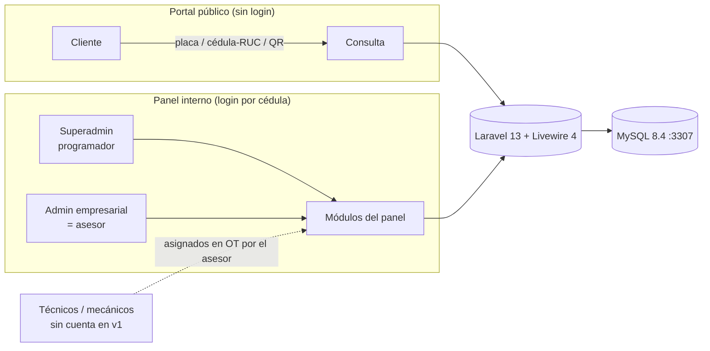
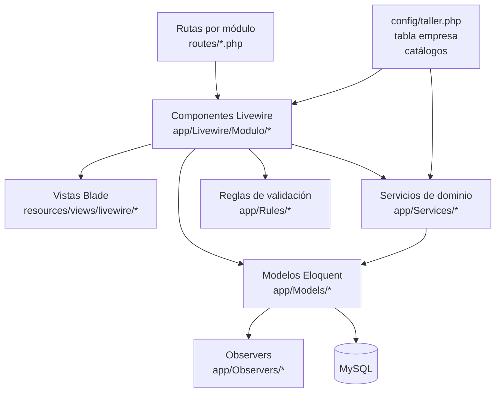
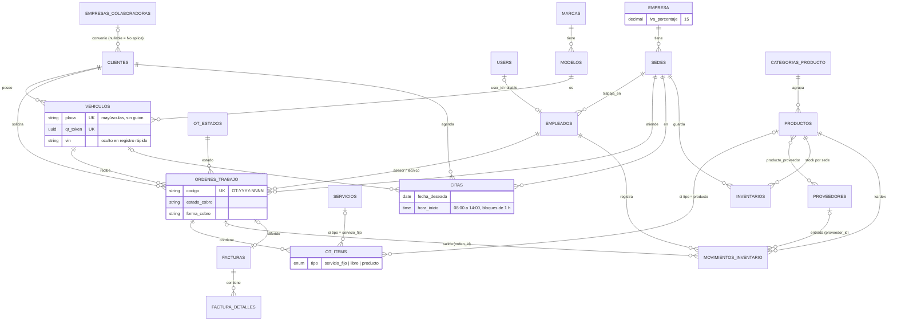
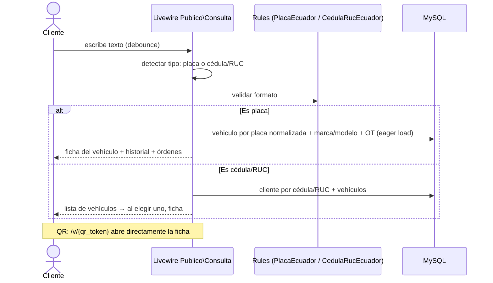
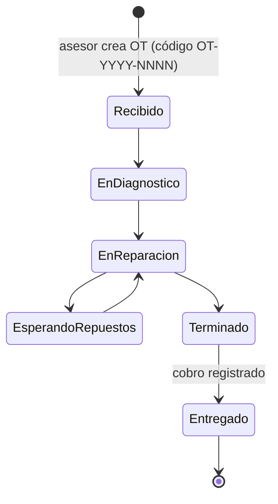
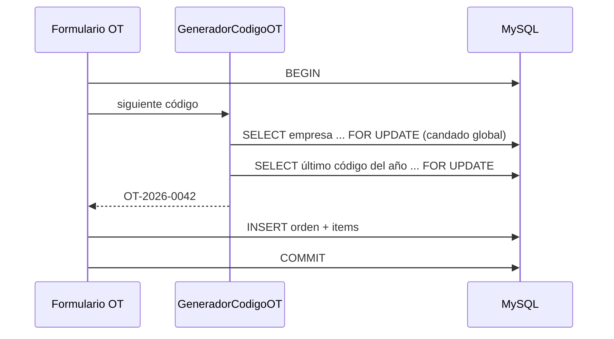
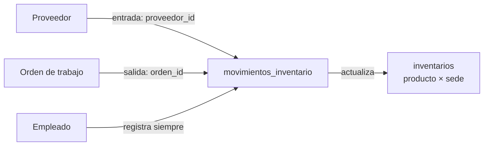
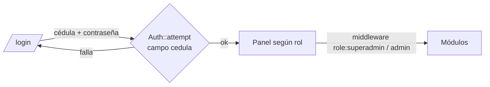
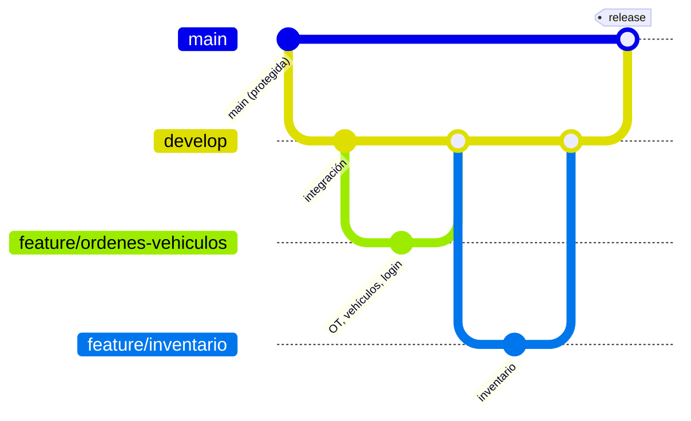

# Arquitectura — Sistema de Taller Automotriz

> Documento de referencia para personas y agentes (Claude Code) que trabajan en el proyecto.
> Explica **qué hace cada parte**, cómo se conectan y qué reglas no se rompen.
> Redactado: 2026-11-21 · Entrega comprometida: **11 de diciembre de 2026**.
> Fuente: documento de traspaso del 2026-11-20. Lo que no estaba definido allí aparece marcado como **Supuesto** (ver §15).

---

## Índice

1. Visión general
2. Actores y permisos
3. Stack y entorno
4. Arquitectura en capas
5. Mapa de carpetas (qué hace cada cosa)
6. Módulos funcionales
7. Modelo de datos
8. Flujos clave
9. Lógica de negocio (servicios, reglas, observers)
10. Rendimiento: "optimizado como un videojuego"
11. Diseño visual (paleta ERP)
12. Configuración: nada quemado
13. Pruebas y calidad
14. Equipo, propiedad del código y Git
15. Supuestos, ambigüedades y riesgos
16. Glosario

---

## 1. Visión general

Sistema web para **dar seguimiento a los vehículos que pasan por un taller automotriz con varias sedes** (Quito, Ecuador).

Tiene dos caras:

- **Panel interno** (con login): el personal administrativo registra clientes, vehículos, órdenes de trabajo (OT), citas, empleados, convenios y configuración.
- **Portal público** (sin login): el cliente escribe su **placa** o su **cédula/RUC** (o escanea el **QR** del vehículo) y ve la descripción del vehículo, su historial de mantenimiento y sus órdenes de servicio.



---

## 2. Actores y permisos

| Actor | Rol de acceso (Spatie) | Qué puede hacer | Cómo entra |
|---|---|---|---|
| Programador | `superadmin` | Todo, incluida configuración técnica y catálogos sensibles | Login por cédula |
| Admin empresarial / asesor | `admin` | Operar el negocio: clientes, vehículos, OT, citas, empleados, convenios, configuración del negocio. No ve nada técnico (BD, logs, etc.) | Login por cédula |
| Operador (técnico/mecánico) | ninguno en v1 | Nada en el sistema. Es un registro en `empleados` con `user_id = null` que el asesor asigna a las OT | No entra |
| Cliente | ninguno | Consultar su vehículo y pedir cita en el portal público | Sin login: placa, cédula/RUC o QR |

Distinción importante:

- **Cargo** (`empleados.cargo`): qué hace la persona en el taller (mecánico, asesor, jefe de taller…). Es un dato descriptivo.
- **Rol de acceso** (Spatie): qué puede hacer en el sistema. Son datos en BD, no constantes en código.

Un empleado puede existir sin usuario (técnico) y un usuario puede estar vinculado a un empleado (la admin de los seeders, María F. López).

---

## 3. Stack y entorno

### Versiones fijadas (no se actualizan sin acuerdo)

| Pieza | Versión |
|---|---|
| PHP | 8.3.x (`^8.3`) |
| Laravel | 13.43.0 |
| Livewire | 4.4.8 |
| Volt | 1.11.2 (solo pantallas de auth) |
| Flux | 2.21.0 (restos del starter kit; **no se usa en el panel**) |
| spatie/laravel-permission | 8.5.0 |
| barryvdh/laravel-dompdf | 3.1.2 (PDF de OT) |
| simplesoftwareio/simple-qrcode | 4.2.0 (QR de vehículos) |
| MySQL | 8.4.3 |
| CSS | Tailwind (plano) |

`composer.lock` y `package-lock.json` se commitean. Instalar siempre con `composer install` y `npm ci`.

### Entorno local (Laragon, Windows)

| Elemento | Valor |
|---|---|
| Ruta | `C:\laragon\www\Taller-Automotriz` |
| URL | `http://taller-automotriz.test:8080` (Apache, vhost de Laragon) |
| Servidor | Apache **8080**. No se usa `php artisan serve` |
| MySQL | puerto **3307**. BD `taller_automotriz` y `taller_automotriz_test` |
| Zona horaria / idioma | `America/Guayaquil` / `es` |

Trampa conocida: variables de entorno "fantasma" (`DB_*`, `APP_KEY`) de otro proyecto pueden pisar el `.env`. Revisar con `Get-ChildItem Env:` y limpiar con `Remove-Item Env:DB_*,Env:APP_KEY`.

---

## 4. Arquitectura en capas

El sistema es un **monolito Laravel** con componentes Livewire de página completa. No hay API REST ni SPA en JavaScript: la interactividad la da Livewire, y la navegación sin recarga la da `wire:navigate`.



| Capa | Responsabilidad | No debe |
|---|---|---|
| **Rutas** (`routes/{modulo}.php`) | Asociar URL → componente Livewire, con middleware de auth/rol | Tener lógica |
| **Componentes Livewire** | Estado de la pantalla, validación, orquestar llamadas | Contener reglas de negocio complejas (van a Services) ni SQL crudo disperso |
| **Vistas Blade** | Presentación con Tailwind y la paleta ERP | Hacer consultas a BD (nada de `$modelo->relacion` sin eager loading) |
| **Services** | Reglas de negocio reutilizables y transaccionales (código OT, descuentos, totales) | Conocer la UI |
| **Models** | Relaciones, casts, scopes, accessors | Lógica de pantalla |
| **Observers** | Efectos automáticos al guardar (normalizar placa, generar `qr_token`, invalidar cachés, asignar código OT) | Lógica que dependa del usuario en pantalla |
| **Rules** | Validaciones ecuatorianas reutilizables | — |
| **Config** | Parámetros del negocio y del sistema | — |

Regla práctica: si una regla se usa en más de un componente, o necesita transacción o bloqueo, va a `app/Services/`.

---

## 5. Mapa de carpetas (qué hace cada cosa)

```
app/
  Livewire/
    Ordenes/          Listado, Formulario (crear/editar OT, líneas, totales, cobro), detalle/PDF
    Vehiculos/        CRUD de vehículos, registro rápido (VIN oculto), QR
    Clientes/         CRUD de clientes, vínculo con empresa colaboradora
    Convenios/        Empresas colaboradoras y su % de descuento
    Citas/            Agenda interna de citas (franjas 08:00–14:00)
    Empleados/        Técnicos, asesores (cargo; user_id opcional)
    Configuracion/    Datos de empresa, sedes, catálogos (marcas, modelos, servicios, checklist, estados OT)
    Publico/          Portal sin login: consulta por placa / cédula-RUC / QR, solicitud de cita
    Inventario/       ⚠ ZONA DEL SEGUNDO DEV
  Models/             Empresa, Sede, User, Empleado, EmpresaColaboradora, Cliente, Marca, Modelo,
                      Vehiculo, Servicio, ChecklistItem, OtEstado, OrdenTrabajo, OtItem, Cita,
                      Factura, FacturaDetalle
    Inventario/       ⚠ ZONA DEL SEGUNDO DEV (Producto, Proveedor, Inventario, Movimiento…)
  Observers/          OrdenTrabajoObserver, VehiculoObserver
  Services/           GeneradorCodigoOT, CalculadorDescuento
  Rules/              CedulaRucEcuador, PlacaEcuador

config/
  taller.php          Parámetros del sistema (ver §12)
  livewire.php        Config mínima (evita un 500 en Profile con Livewire 4). No borrar.

resources/views/
  components/layouts/
    panel.blade.php   Layout del panel (menú lateral, cabecera, @persist del menú)
    publico.blade.php Layout del portal público
  livewire/
    auth/login.blade.php   Volt; Auth::attempt por cédula
    <modulo>/...           Vistas de cada componente
    inventario/            ⚠ ZONA DEL SEGUNDO DEV

routes/
  web.php             Carga los archivos de módulo
  ordenes.php  clientes.php  vehiculos.php  citas.php  empleados.php  publico.php
  inventario.php      ⚠ ZONA DEL SEGUNDO DEV (hoy vacío)

database/
  migrations/         2026_11_20_1000xx_* (esquema definitivo) + 2026_11_21_000001_add_cedula_to_users_table
  seeders/            RolesSeeder, OrganizacionSeeder, CatalogosSeeder, DemoOperacionSeeder

lang/es/              Traducciones (validación, auth, etiquetas)
tests/Feature/        TallerOrdenesTest, TallerModulosTest, tests de login
```

---

## 6. Módulos funcionales

| Módulo | Dueño | Qué hace | Tablas principales | Estado |
|---|---|---|---|---|
| Autenticación | Sebastian | Login por cédula + contraseña, sin registro público | `users`, Spatie | Hecho (con tests) |
| Layout / navegación | Sebastian | Panel y portal, navegación sin recarga | — | Hecho |
| Clientes | Sebastian | Alta/edición, búsqueda, convenio asociado | `clientes` | Hecho |
| Convenios | Sebastian | Empresas colaboradoras con % de descuento | `empresas_colaboradoras` | Hecho |
| Vehículos / QR | Sebastian | Registro (rápido y completo), placa única normalizada, QR por `qr_token` | `vehiculos`, `marcas`, `modelos` | Hecho |
| Órdenes de trabajo | Sebastian | Crear OT, líneas (servicio fijo, libre, producto), técnicos, estados, checklist, totales con descuento e IVA, cobro simple, PDF | `ordenes_trabajo`, `ot_items`, `ot_estados`, `servicios`, `checklist_items` | Hecho |
| Citas | Sebastian | Agenda en franjas de 1 h (08–14) | `citas` | Hecho |
| Empleados | Sebastian | Personal, cargo, vínculo opcional a usuario | `empleados` | Hecho |
| Configuración | Sebastian | Datos de empresa, sedes, catálogos, IVA | `empresa`, `sedes`, catálogos | Hecho |
| Portal público | Sebastian | Consulta por placa / cédula-RUC / QR | lectura de varias | Hecho |
| **Inventario** | **Segundo dev** | Productos, categorías, proveedores, stock por sede, kardex | 6 tablas de inventario | Por hacer |
| Facturación | — | UI de facturas y SRI | `facturas`, `factura_detalles` | Diferido |

---

## 7. Modelo de datos

22 tablas de negocio (más las de Laravel y Spatie).

### 7.1 Grupos

- **Organización y personas:** `empresa`, `sedes`, `users`, `empleados`, `empresas_colaboradoras`, `clientes`
- **Vehículos:** `marcas`, `modelos`, `vehiculos`
- **Catálogos de operación:** `servicios`, `checklist_items`, `ot_estados`
- **Órdenes:** `ordenes_trabajo`, `ot_items`
- **Inventario:** `categorias_producto`, `proveedores`, `productos`, `producto_proveedor`, `inventarios`, `movimientos_inventario`
- **Facturación (diferida):** `facturas`, `factura_detalles`
- **Citas:** `citas`

### 7.2 Diagrama entidad-relación (simplificado)

Solo se muestran claves y campos relevantes. La verdad está en las migraciones.



**Supuesto:** las relaciones exactas de OT con técnicos (¿uno o varios por OT?) y de citas con vehículo se deben confirmar en las migraciones. El diagrama muestra la intención, no columnas exactas.

### 7.3 Decisiones de modelado

- **Multi-sede desde el inicio.** OT, citas, empleados e inventario cuelgan de una sede.
- **Placa única global**, normalizada (mayúsculas, sin guion) antes de guardar y antes de buscar.
- **`qr_token` (UUID)** en cada vehículo. El QR apunta a una URL pública con ese token, nunca con el `id`.
- **Inventario no se vincula a clientes.** Salidas llevan `orden_id`; entradas llevan `proveedor_id`; siempre `empleado_id`, `producto_id`, `sede_id`.
- **Facturación** tiene tablas con campos SRI nullable, pero sin UI en v1.

### 7.4 Índices que deben existir (verificar)

| Tabla | Índice | Por qué |
|---|---|---|
| `vehiculos` | UNIQUE `placa`, UNIQUE `qr_token`, `cliente_id` | Consulta pública y listado por cliente |
| `clientes` | UNIQUE `cedula_ruc` (**supuesto** de nombre de columna) | Consulta pública por cédula/RUC |
| `ordenes_trabajo` | UNIQUE `codigo`, `vehiculo_id`, `(sede_id, ot_estado_id)`, `created_at` | Historial, tablero, listados |
| `ot_items` | `orden_trabajo_id` | Detalle de OT |
| `citas` | `(sede_id, fecha_deseada, hora_inicio)` | Disponibilidad de franjas |
| `inventarios` | UNIQUE `(producto_id, sede_id)` | Stock por sede |
| `movimientos_inventario` | `(producto_id, sede_id, created_at)` | Kardex |
| `users` | UNIQUE `cedula` | Login |

---

## 8. Flujos clave

### 8.1 Consulta pública (placa, cédula/RUC o QR)



Qué muestra la ficha:

1. **Descripción breve:** placa, marca, modelo, año, color (**supuesto** de campos).
2. **Órdenes de servicio:** abiertas y su estado actual.
3. **Historial de mantenimiento:** OT cerradas con fecha, servicios realizados y kilometraje (**supuesto**).

Reglas:

- Sin verificación adicional (decisión del cliente).
- El portal **no muestra** precios internos, datos de contacto de otros clientes, ni notas internas de la OT (**supuesto razonable**: confirmar con el dueño qué campos son públicos).
- Recomendado: limitar intentos por IP (`throttle`) porque la cédula sin verificación expone datos. Ver §15.

### 8.2 Ciclo de vida de una orden de trabajo



**Supuesto:** los nombres de estado son ilustrativos. Los estados reales son **datos** de `ot_estados` (catálogo configurable), no un enum en código.

Pasos de creación:

1. Buscar o registrar vehículo (registro rápido, VIN oculto).
2. El cliente sale del vehículo; su convenio determina el descuento.
3. Agregar líneas en `ot_items`:
   - `servicio_fijo`: precio desde `servicios`.
   - `libre`: descripción y precio manual.
   - `producto`: desde inventario (**punto de integración**, marcado `// TODO INVENTARIO` en `app/Livewire/Ordenes/Formulario.php`).
4. Asignar técnico(s) (empleados sin usuario).
5. Checklist de recepción (`checklist_items`).
6. Totales: subtotal → descuento (`CalculadorDescuento`) → IVA (`empresa.iva_porcentaje`) → total.
7. Guardar en transacción. `GeneradorCodigoOT` asigna el código de forma atómica.
8. Cobro simple: `estado_cobro`, `forma_cobro`. PDF con dompdf.

### 8.3 Generación del código de OT (concurrencia)



El orden de bloqueo (primero `empresa`, luego OT) es lo que evitó los deadlocks. **No cambiarlo.**

### 8.4 Citas

- El cliente elige fecha y una franja de 1 hora entre 08:00 y 14:00.
- Las franjas se calculan desde `config/taller.php` (hora inicio, fin, duración), no se escriben en la vista.
- **Supuesto:** capacidad por franja y por sede (cuántos vehículos a la vez) se lee de configuración. Si no existe, definirla antes de tocar la lógica.

### 8.5 Inventario (segundo dev)



- El stock vive en `inventarios`; el historial en `movimientos_inventario` (kardex).
- Cada movimiento actualiza el stock dentro de la misma transacción, con `lockForUpdate` sobre la fila de `inventarios`.
- Integración con OT: cuando se agrega una línea `producto` a una OT, se crea la salida. **Supuesto:** el momento exacto (al agregar la línea o al cerrar la OT) lo acuerdan ambos devs por PR.

### 8.6 Autenticación



- Login es una página completa sobria (Volt), no un modal.
- Sin registro público. Los usuarios se crean desde el panel o seeders.
- Seeders: 2 `superadmin` + 1 `admin`. En desarrollo usuario = contraseña = cédula. **Cambiar antes de producción.**

---

## 9. Lógica de negocio

| Pieza | Ubicación | Qué hace |
|---|---|---|
| `GeneradorCodigoOT` | `app/Services/` | Código `OT-YYYY-NNNN` atómico, reinicia por año |
| `CalculadorDescuento` | `app/Services/` | % de la empresa colaboradora del cliente; 0 si "No aplica" |
| IVA | `empresa.iva_porcentaje` | 15 % hoy; se lee de BD siempre |
| `OrdenTrabajoObserver` | `app/Observers/` | Efectos al crear/actualizar OT (código, cachés) |
| `VehiculoObserver` | `app/Observers/` | Normaliza placa, genera `qr_token`, invalida cachés |
| `CedulaRucEcuador` | `app/Rules/` | Cédula: módulo 10. RUC: 13 dígitos terminando en `001` |
| `PlacaEcuador` | `app/Rules/` | Formato de placa; se guarda en mayúsculas sin guion |

Orden de cálculo de totales (**supuesto**, confirmar en el código): `subtotal = Σ líneas`, `descuento = subtotal × %convenio`, `base = subtotal − descuento`, `iva = base × iva%`, `total = base + iva`. Usar `decimal`/BCMath o enteros en centavos, nunca `float`.

---

## 10. Rendimiento: "optimizado como un videojuego"

Objetivo: cada interacción se siente inmediata y nunca hay recarga completa.

| Técnica | Dónde | Regla |
|---|---|---|
| `wire:navigate` en todos los enlaces internos | Panel y portal | Ningún `<a>` interno sin `wire:navigate` |
| `@persist` | Menú lateral y cabecera del layout | El menú no se vuelve a renderizar al navegar |
| `wire:model.live.debounce.300ms` | Buscadores | Nunca `.live` sin debounce en texto |
| `wire:model` (diferido) / `.blur` | Formularios | Solo `.live` cuando la UI lo necesite |
| `wire:key` | Todo `@foreach` | Obligatorio |
| `#[Computed]` | Datos derivados y listas | En vez de propiedades públicas pesadas |
| `#[Lazy]` + placeholder | Widgets costosos | Carga diferida |
| Propiedades públicas pequeñas | Componentes | Guardar IDs, no colecciones enteras |
| Eager loading (`with`, `withCount`) | Consultas | Cero N+1; `Model::preventLazyLoading()` en desarrollo |
| Paginación y `select` de columnas | Listados | Nunca `->get()` de tablas grandes |
| Caché con invalidación | Catálogos, datos de empresa, config | Invalidar desde observers al guardar |
| `wire:loading` / `wire:dirty` | Botones y formularios | Feedback inmediato sin bloquear la UI |
| Alpine para interacciones puramente visuales | Pestañas, modales | No hacer viaje al servidor si no hace falta |

Antes de cerrar una tarea: correr tests y anotar el número de consultas por pantalla (Debugbar o `DB::listen` en un test).

---

## 11. Diseño visual (ERP sobrio)

| Token | Valor | Uso |
|---|---|---|
| Fondo | `#F4F5F7` | `body` |
| Superficie | `#FFFFFF` + borde 1px `#D1D5DB` | Tarjetas, tablas, formularios |
| Texto | `#1F2937` | Todo el texto principal |
| Acento único | `#1E40AF` (azul acero) | Botón primario, enlaces, foco, elemento activo del menú |

Reglas:

- Nada de degradados, sombras grandes, ilustraciones, emojis ni look "startup/IA".
- Un solo color de acento. Los estados (éxito, alerta, error) usan tonos sobrios y siempre con texto, no solo color.
- Tablas densas, tipografía legible, alineación numérica a la derecha.
- **Sin logo real todavía:** usar un placeholder neutro (rectángulo con el nombre de `empresa`). No inventar logo ni iconografía de marca.
- **Sin Flux en el panel.** Tailwind plano. Lo ideal es definir los colores como tokens en el tema de Tailwind (no repetir hex en cada vista).

---

## 12. Configuración: nada quemado

| Dónde | Qué va |
|---|---|
| `.env` | Credenciales, URL, puertos (`DB_PORT=3307`), entorno |
| `config/taller.php` | Parámetros del sistema: horario de citas (inicio, fin, duración), formato del código OT, tamaños de página, TTL de cachés, throttling del portal (**supuesto**: crear claves que falten) |
| Tabla `empresa` | Datos del negocio: nombre, RUC, dirección, teléfono, `iva_porcentaje` |
| Tablas de catálogo | Marcas, modelos, servicios, checklist, estados de OT, cargos (**supuesto**: si cargo es texto libre o catálogo, confirmar) |
| Spatie | Roles y permisos como datos |
| `lang/es/*` | Textos de la interfaz |

Si un valor puede cambiar algún día por decisión del negocio, no va en el código.

---

## 13. Pruebas y calidad

- Tests en `tests/Feature/` (49 en verde al último reporte). BD de pruebas `taller_automotriz_test` en el puerto 3307.
- Toda funcionalidad nueva lleva al menos un test Feature del camino feliz y uno de validación.
- Tests de regresión para: código OT concurrente, cálculo de descuento + IVA, normalización de placa, validación de cédula/RUC, consulta pública por los tres medios, login por cédula.
- Antes de un PR: `php artisan test` en verde + revisión del número de consultas de las pantallas tocadas.

---

## 14. Equipo, propiedad del código y Git

### Reparto

| Persona | Zona |
|---|---|
| **Sebastian** (dueño) | Todo excepto Inventario: auth, layout, clientes, convenios, vehículos/QR, OT, citas, empleados, configuración, portal |
| **Segundo dev** | Solo Inventario: `app/Livewire/Inventario/`, `app/Models/Inventario/`, `resources/views/livewire/inventario/`, `routes/inventario.php` |

Cambios fuera de la zona propia: se coordinan por PR, nunca directos.

### Ramas



- `main`: protegida, solo por PR desde `develop`.
- `develop`: integración.
- `feature/*`: una por funcionalidad, creada desde `develop`.
- Commits pequeños y descriptivos en español.
- Lock files commiteados; no actualizar dependencias sin acuerdo.

### Próximos pasos (según traspaso)

1. `php artisan migrate:fresh --seed` (borra datos locales) y confirmar login.
2. Commit del trabajo de login.
3. Prompt de optimización en 3 fases (auditoría → aplicar → verificar), sin tocar Inventario ni Facturación.
4. PR `feature/ordenes-vehiculos` → `develop`; proteger `main`; invitar al segundo dev.
5. Segundo dev crea `feature/inventario` desde `develop`.

---

## 15. Supuestos, ambigüedades y riesgos

| # | Tema | Situación | Qué se asumió |
|---|---|---|---|
| 1 | **Quién hace el login** | Las notas del proyecto dicen que el segundo dev se encarga del login; el traspaso (más reciente) dice que el login ya está hecho por Sebastian y el segundo dev solo hace Inventario | Se sigue el **traspaso**. Confirmar con el equipo |
| 2 | Campos públicos de la ficha | No se definió qué datos ve el cliente | Se ocultan precios internos, notas internas y datos de terceros |
| 3 | Seguridad de la consulta por cédula | Sin verificación, alguien puede ver vehículos de otra persona con solo su cédula | Decisión del cliente, se respeta. **Recomendado** añadir throttling por IP y no mostrar datos personales más allá del nombre |
| 4 | Estados de OT | No listados en el traspaso | Son datos de `ot_estados`; los del diagrama son ejemplos |
| 5 | Técnicos por OT | No se aclara si es uno o varios | Revisar migración antes de cambiar |
| 6 | Capacidad de citas por franja | No definida | Parámetro de configuración por sede |
| 7 | Momento de descontar stock | No definido | Se acuerda por PR entre ambos devs |
| 8 | Nombre de columnas (`cedula_ruc`, campos de vehículo) | No están en el traspaso | Verificar en migraciones; este documento no es la fuente de verdad del esquema |
| 9 | Versiones del stack | Se toman tal cual del traspaso | No se actualizan |
| 10 | Contraseñas de seeders | Usuario = contraseña en desarrollo | Riesgo si llega a producción: cambiar antes de desplegar |

---

## 16. Glosario

| Término | Significado |
|---|---|
| OT | Orden de trabajo (orden de servicio) |
| Asesor | Admin logueado que recibe el vehículo y crea la OT |
| Convenio / empresa colaboradora | Empresa con acuerdo de descuento para sus clientes |
| Sede | Local físico del taller |
| Kardex | Historial de movimientos de inventario |
| SRI | Servicio de Rentas Internas (facturación electrónica en Ecuador) |
| Cédula / RUC | Identificación de persona (10 dígitos) / contribuyente (13 dígitos, termina en 001) |
| Registro rápido | Alta de vehículo con los mínimos datos (VIN oculto) |
